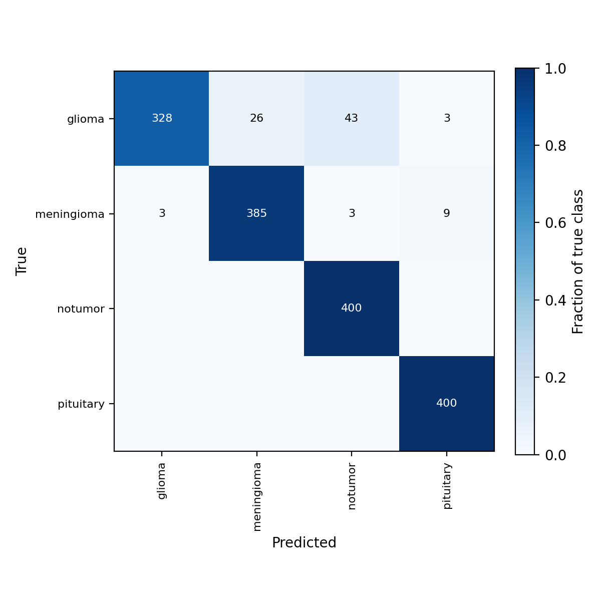
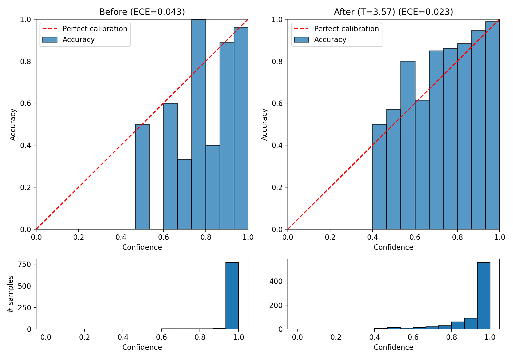

# Brain Tumor MRI Classification with InceptionV3 (Transfer Learning)

Four-class brain MRI classifier (glioma, meningioma, no tumor, pituitary) built by fine-tuning a pretrained InceptionV3 with PyTorch and timm. The repo also contains a post-hoc analysis of the trained model: confusion matrix, grouped error analysis and calibration with temperature scaling, all run on an ONNX export of the model using ONNX Runtime.

> **Disclaimer:** this is a learning / research project. It is not a medical device and must not be used for diagnosis.

---

## Dataset

[Brain Tumor MRI Dataset](https://www.kaggle.com/datasets/masoudnickparvar/brain-tumor-mri-dataset) (Kaggle, `masoudnickparvar`), downloaded automatically with `kagglehub` in the training notebook.

| Split | glioma | meningioma | notumor | pituitary | Total |
|-------|-------:|-----------:|--------:|----------:|------:|
| Train | 1400 | 1400 | 1400 | 1400 | 5600 |
| Test  | 400  | 400  | 400  | 400  | 1600 |

Classes are balanced in both splits.

## Model and training

| Item | Setting |
|------|---------|
| Backbone | `inception_v3.tv_in1k` (timm, ImageNet pretrained) |
| Input | 299 x 299, grayscale replicated to 3 channels, ImageNet mean/std |
| Fine-tuning | Everything frozen except `Mixed_7a`, `Mixed_7b`, `Mixed_7c` and `fc` (12.8M of 21.8M parameters trainable) |
| Optimizer | AdamW, weight decay 1e-4, lr 1e-4 (backbone) and 1e-3 (head) |
| Loss / batch size / epochs | Cross-entropy, 32, 10 |
| Augmentation | Horizontal flip, affine (±10°, 5% translate, 0.95–1.05 scale), brightness/contrast jitter (0.15) |
| BatchNorm | BatchNorm layers in frozen blocks are kept in eval mode during training |

### Training history

| Epoch | Train loss | Train acc | Test loss | Test acc |
|------:|-----------:|----------:|----------:|---------:|
| 1  | 0.3137 | 0.8905 | 0.3179 | 0.9169 |
| 2  | 0.1135 | 0.9605 | 0.3798 | 0.9256 |
| 3  | 0.0766 | 0.9729 | 0.4280 | 0.9356 |
| 4  | 0.0552 | 0.9812 | 0.4941 | 0.9306 |
| 5  | 0.0604 | 0.9807 | 0.4732 | 0.9456 |
| 6  | 0.0460 | 0.9823 | 0.5621 | 0.9406 |
| 7  | 0.0312 | 0.9886 | 0.5029 | 0.9506 |
| 8  | 0.0362 | 0.9882 | 0.4656 | 0.9513 |
| 9  | 0.0284 | 0.9893 | 0.6463 | 0.9506 |
| 10 | 0.0292 | 0.9893 | 0.6441 | 0.9456 |

Test accuracy keeps improving slowly while test loss rises from epoch 2 onwards. That pattern (more accurate but increasingly overconfident) is what the calibration analysis below looks at. The saved checkpoint is the **final epoch (10)**.

## Export

The trained model is saved as a PyTorch checkpoint (weights, architecture name, class names and the timm data config) and exported to ONNX (`opset 17`, dynamic batch axis, raw **logits** as output so temperature scaling is possible). All analysis runs through ONNX Runtime.

## Analysis

All analysis lives in `notebooks/Analysis.ipynb`. Raw logits are computed once and cached in `analysis_out/`, so each step reloads them instead of re-running the model.

1. **Confusion matrix** - row-normalised heatmap, per-class precision / recall / F1, most confused class pairs.
2. **Error analysis** - every misclassified test image is saved to `misclassified.csv` with its confidence and the probability given to the true class. Errors are grouped by cause (confident-wrong, near-miss between similar classes, low confidence, blur, bad exposure) and visualised as image grids of up to 50 examples per group. The automatic tags are a first pass and were checked by manual inspection of the grids.
3. **Calibration** - expected calibration error (ECE, 15 bins), negative log-likelihood, reliability diagrams, and **temperature scaling** (a single scalar `T` that divides the logits, fitted by minimising NLL with L-BFGS).

### Results

| Metric | Value |
|--------|-------|
| Test accuracy (ONNX) | TBD |
| Misclassified images | TBD / 1600 |
| Fitted temperature `T` | TBD |
| ECE before / after scaling | TBD / TBD |
| NLL before / after scaling | TBD / TBD |

Figures (generated into `analysis_out/`):





Error grids per cause are saved as `analysis_out/errors_<cause>.png`.

## Repository structure

```
.
├── notebooks/
│   ├── Inception.ipynb      # data, training, checkpoint + ONNX export
│   └── Analysis.ipynb       # confusion matrix, error analysis, calibration
├── analysis_out/            # cached logits, tables and figures
├── models/                  # best_model.pth, best_model.onnx (not tracked, see below)
├── data/                    # downloaded dataset (not tracked)
├── requirements.txt
└── README.md
```

## Reproducing

```bash
pip install -r requirements.txt

# 1. Train and export (downloads the dataset into ./data)
jupyter lab notebooks/Inception.ipynb

# 2. Run the analysis on the ONNX model
jupyter lab notebooks/Analysis.ipynb
```

The analysis notebook must use **exactly the same test-time preprocessing as training** (grayscale to 3 channels, resize to 299 x 299, ImageNet normalisation). Using a different transform, for example timm's default resize-and-crop, changes the predictions and invalidates the numbers.

Model files are large (roughly 90 MB each), so they are not committed. Train them with the notebook, or download them from the repository's Releases page if provided.

## Limitations

- **No separate validation set.** Only train and test directories exist. The test set was evaluated after every epoch for monitoring, although the final epoch is the one saved (no checkpoint selection on test accuracy).
- **Calibration split.** Because there is no validation set, the test set is split 50/50 (stratified, fixed seed). The temperature is fitted on one half and ECE / NLL are reported on the other half. Confusion matrix and error analysis use the full test set.
- **Single training run**, no confidence intervals across seeds.
- **Heuristic error causes.** The automatic cause tags depend on hand-chosen thresholds, and the final interpretation relies on manual inspection of the image grids.
- Results apply to this dataset only and say nothing about performance on scans from other scanners or hospitals.

## Possible future work

- Grad-CAM or other saliency maps to check whether errors come from attention outside the lesion.
- A proper train / validation / test split and multiple seeds.
- Compare against other backbones and stronger regularisation.

## Tech stack

PyTorch, timm, torchvision, ONNX / ONNX Runtime, scikit-learn, NumPy, pandas, matplotlib.
